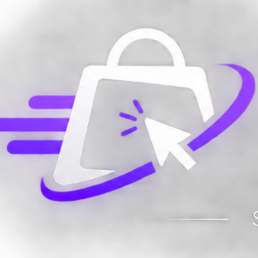

# BuyNova — Smart Commerce Platform

<p align="center">
  
</p>

<p align="center">
  <b>A modern, standalone e-commerce storefront with Supabase database integration, built-in Node.js server, and live order tracking.</b>
</p>

<p align="center">
  <a href="#author"></a>
  <a href="#license"></a>
  <a href="https://supabase.com/"></a>
  
  
</p>

---

## 🌟 Overview

**BuyNova** is a lightweight, full-stack headless e-commerce application designed for modern web commerce. It combines a responsive frontend with a robust Supabase PostgreSQL database and a self-contained Node.js server (`server.js`) that runs with zero external framework lock-in.

Whether deployed on a cloud hosting platform (Render, Railway, VPS, Docker) or run locally, BuyNova demonstrates production-ready patterns: real database queries with Row Level Security, transactional inventory reservation, server-side customer support handling, and real-time order tracking.

---

## 👨‍💻 Author & Creator

| Profile | Details |
| :--- | :--- |
| **Name** | **Lakshya Chandra** |
| **Personal Brand** | **Lakshya.Tech** |
| **Role** | Aspiring AI/ML & Software Engineer |
| **Education** | B.Tech CSE (Artificial Intelligence & Machine Learning) |
| **Institute** | PW Institute of Innovation |
| **Portfolio Tagline** | *"Building Today. Innovating Tomorrow."* |
| **GitHub** | [@Lakshya-tech2026](https://github.com/Lakshya-tech2026) |
| **LinkedIn** | [lakshya-tech-0042ba433](https://www.linkedin.com/in/lakshya-tech-0042ba433) |
| **Email** | [lakshya.tech2026@gmail.com](mailto:lakshya.tech2026@gmail.com) |

---

## ✨ Features

- 🛍️ **Dynamic Product Catalog**: Products, pricing, and stock fetched live from Supabase PostgreSQL with graceful static fallback if the database is offline.
- 🔍 **Instant Search & Category Filters**: Client-side filtering by category chips and search queries with zero latency.
- 🛒 **Persistent Shopping Cart**: State synchronized to `localStorage` (`buynova-cart`) with quantity management and stock limit enforcement.
- 📝 **Delivery Checkout**: Multi-field address validation (name, phone, address, city, state, pincode).
- 💵 **Cash on Delivery (COD)**: Fully functional order placement that writes records to `customers`, `orders`, `order_items`, and `payments`.
- 📦 **Atomic Inventory Reservation**: Automatically decrements product stock upon order creation and rolls back if subsequent writes fail.
- 🚚 **Live Order Tracking**: Instant tracking using order numbers (`BN-XXXXXXXX`) with a 4-milestone visual pipeline (*Order Received* ➔ *Being Prepared* ➔ *Shipped* ➔ *Delivered*).
- 💬 **Customer Support Ticketing**: Dedicated `/contact/` portal with anti-spam honeypot and secure server-side message storage.
- 🛡️ **Row-Level Security (RLS)**: Client code cannot access customer or payment tables directly; only server API routes with the Supabase secret key can mutate order records.
- 📱 **Mobile-First Responsive UI**: Smooth slide-over drawer cart, modal dialogs, and clean design on mobile, tablet, and desktop.
- ⚖️ **Store Policies**: Dedicated pages for Shipping Policy, Returns & Refunds, Privacy Policy, and Terms & Conditions.

---

## 🛠️ Tech Stack

- **Frontend**: Semantic HTML5, Vanilla JavaScript (ES6+), CSS3 with CSS variables and responsive Grid/Flexbox
- **Backend**: Node.js built-in HTTP server (`server.js`) with zero external runtime dependencies
- **Database**: [Supabase](https://supabase.com/) (PostgreSQL with Row Level Security)
- **Deployment**: Any standard Node.js host (Render, Railway, VPS, Docker, Heroku)

---

## 📁 Project Structure

```text
buynova/
├── api/                        # Backend API endpoints
│   ├── _supabase.js            # Supabase admin client initialization
│   ├── contact.js              # Support ticket submission endpoint
│   ├── create-order.js         # Atomic order creation & stock reservation
│   ├── products.js             # Active product catalog API
│   └── track-order.js          # Order status lookup endpoint
├── assets/
│   └── logo.png                # Official BuyNova branding logo
├── contact/
│   └── index.html              # Customer support & message form page
├── privacy/
│   └── index.html              # Privacy policy
├── returns/
│   └── index.html              # Returns & refunds policy
├── shipping/
│   └── index.html              # Shipping & delivery policy
├── terms/
│   └── index.html              # Terms & conditions
├── supabase/
│   ├── schema.sql              # Complete database schema, tables & RLS
│   └── support_messages.sql    # Standalone support messages migration
├── .env.example                # Sample environment variables
├── .gitignore                  # Git ignore rules (protects credentials)
├── DEPLOYMENT.md               # Step-by-step production deployment instructions
├── index.html                  # Main storefront application
├── package.json                # Project scripts and dependencies
├── robots.txt                  # Search engine crawl directives
├── server.js                   # Standalone Node.js server (serves static & API)
└── sitemap.xml                 # XML sitemap for SEO
```

---

## 🚀 Quick Start (Local Development)

### 1. Clone & Install

```bash
git clone https://github.com/Lakshya-tech2026/buynova.git
cd buynova
npm install
```

### 2. Configure Environment

Copy the example environment file:

```bash
cp .env.example .env
```

Edit `.env` and supply your Supabase credentials:

```ini
SUPABASE_URL=https://your-project-id.supabase.co
SUPABASE_SECRET_KEY=your_supabase_service_role_secret_key
PORT=3000
```

### 3. Run Locally

Start the built-in Node server:

```bash
npm start
# or: node server.js
```

Visit [http://localhost:3000](http://localhost:3000) in your browser. Both the storefront and the `/api/*` endpoints work immediately out-of-the-box!

---

## 🌐 Publishing to GitHub & Deploying

### Step 1: Push to GitHub

```bash
git init
git add .
git commit -m "feat: initial commit for BuyNova website"
git branch -M main
git remote add origin https://github.com/Lakshya-tech2026/buynova.git
git push -u origin main
```

### Step 2: Supabase Database Setup

1. Open [Supabase Dashboard](https://supabase.com/dashboard).
2. Navigate to your project's **SQL Editor**.
3. Copy the contents of [`supabase/schema.sql`](supabase/schema.sql) and click **Run**.

### Step 3: Deploy to any Node.js Cloud Provider

Because BuyNova uses a standard `server.js`, you can deploy it anywhere with one command:
- **Render**: Connect repository, set build command to `npm install` and start command to `node server.js`.
- **Railway**: Connect repository; Railway detects `server.js` and deploys automatically.
- **VPS / Docker**: Run `node server.js` behind PM2 or Nginx.

Add `SUPABASE_URL` and `SUPABASE_SECRET_KEY` in your hosting dashboard's Environment Variables.

---

## 🔑 Environment Variables

| Variable | Required | Description |
| :--- | :--- | :--- |
| `SUPABASE_URL` | Yes | Your Supabase project URL (`https://<project>.supabase.co`) |
| `SUPABASE_SECRET_KEY` | Yes | Supabase `service_role` secret key (kept server-side) |
| `PORT` | No | Server port (default: `3000`) |
| `SITE_URL` | No | Base production URL (e.g. `https://buynova.store`) |

---

## 📄 License

This project is licensed under the **MIT License**.

---

<p align="center">
  <b>Built with passion by <a href="https://github.com/Lakshya-tech2026">Lakshya Chandra</a></b><br>
  <i>"Building Today. Innovating Tomorrow."</i>
</p>
